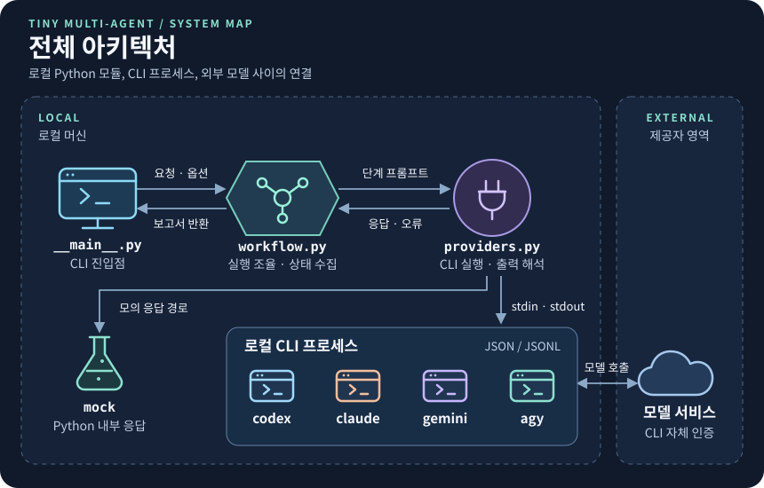
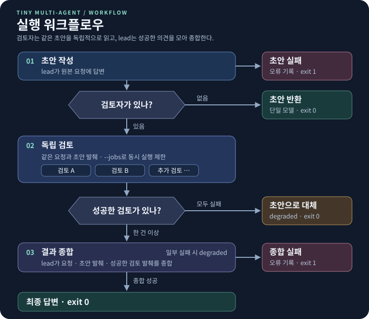

# Tiny Multi-Agent

로컬에 설치된 AI CLI를 한 명령에서 조합하는 학습용 오케스트레이터. **한 에이전트가 초안을 작성하고, 다른 에이전트들이 독립적으로 검토하며, 처음 에이전트가 답변을 종합**한다. Python 3.11 이상과 표준 라이브러리만 사용한다. macOS, Linux, WSL에서 실행할 수 있다.

## 30초 데모

```bash
git clone https://github.com/YuuuuuuYu/tiny-multi-agent.git
cd tiny-multi-agent

python3 -m tiny_multi_agent --lead mock \
  --reviewer mock:accuracy --reviewer mock:tradeoffs \
  "웹 서비스에 Redis 캐시를 언제 도입할까?"
```

`mock`은 로그인과 네트워크가 필요 없다. 같은 명령에 `--jobs 1`을 추가하면 순차 검토, `--jobs 2`를 사용하면 동시 검토다. 두 경우 모두 초안 1회, 검토 2회, 종합 1회를 실행한다. 예제의 인위적인 지연을 기준으로 순차 약 **0.50초**, 병렬 약 **0.30초**가 걸린다.

## 아키텍처와 워크플로우

### 전체 아키텍처



### 에이전트 협업 구조



## 실제 모델 연결

사용할 CLI를 설치하고 해당 CLI에서 인증한 뒤 실행한다. `PROVIDER:MODEL` 형식으로 호출할 모델을 지정할 수 있으며, 생략하면 해당 CLI의 기본 모델을 사용한다.

```bash
python3 -m tiny_multi_agent --lead codex --reviewer claude --reviewer agy \
  "월별 NDJSON 저장소의 조회 성능을 개선하는 방법을 비교해줘."

python3 -m tiny_multi_agent --lead claude:sonnet --reviewer gemini --json \
  "파일 기반 데이터 저장소에서 원자적 쓰기를 설명해줘."

printf '%s\n' '캐시 무효화 전략을 세 가지로 비교해줘.' \
  | python3 -m tiny_multi_agent --lead codex -
```

| 식별자 | 로컬 실행 파일 | 인증 및 비대화형 출력 |
| --- | --- | --- |
| `codex` | `codex` | [Codex CLI 인증](https://developers.openai.com/codex/noninteractive). JSONL의 마지막 에이전트 메시지 사용 |
| `claude` | `claude` | [Claude Code CLI 인증과 설정](https://code.claude.com/docs/en/setup). JSON의 `result` 사용. `--safe-mode`를 지원하는 버전 필요 |
| `gemini` | `gemini` | [Gemini API 키 또는 Vertex AI](https://geminicli.com/docs/get-started/authentication/). JSON의 `response` 사용. Plan Mode 지원 버전 필요 |
| `agy` | `agy` | [Antigravity CLI에서 인증](https://antigravity.google/docs/cli/headless/). JSONL의 성공 `result` 사용 |

Google 개인 계정의 Gemini CLI 로그인은 2026년 6월 18일 종료됐다. 해당 계정으로 Google 모델을 쓰려면 Antigravity CLI의 `agy`를 사용할 수 있다. 실제 모델 호출의 사용량과 과금은 각 CLI에서 선택한 인증과 제공자 정책을 따른다. [Google의 종료 안내](https://developers.google.com/gemini-code-assist/docs/deprecations/code-assist-individuals)

## 코드 읽는 순서

| 파일 | 확인할 부분 |
| --- | --- |
| [`__main__.py`](tiny_multi_agent/__main__.py) | CLI 옵션을 읽고 에이전트를 지정한다. 최종 답변은 stdout, 실행 요약은 stderr에 표시한다 |
| [`workflow.py`](tiny_multi_agent/workflow.py) | 초안에서 검토로, 검토에서 종합으로 넘길 데이터를 구성한다. `asyncio.Semaphore`가 동시 검토 수를 제한하고 `gather`가 입력 순서를 보존한다 |
| [`providers.py`](tiny_multi_agent/providers.py) | 제공자별 명령을 조립하고 stdin으로 프롬프트를 전달한다. CLI의 출력 형식을 공통 답변 문자열로 바꾼다 |

Swarm에서는 활성 에이전트가 함수 호출로 다음 에이전트에 제어권을 넘길 수 있다. 이 구현의 다음 단계와 담당 모델은 사용자가 실행할 때 지정한다. 코드에서 어떤 결과가 어디로 전달되는지 따라가기 쉽고, 순차·병렬 비교에도 같은 작업을 사용할 수 있다. [OpenAI Swarm](https://github.com/openai/swarm) · [Swarm 해설](https://note.com/ndhoang96/n/nfea3a59905bb)

## 비용과 지연을 확인하는 법

- **호출 수** — `--reviewer`를 생략하면 초안 1회로 끝난다. 검토자가 있으면 각각 1회 실행하고, 성공한 검토가 있으면 종합을 1회 실행한다. 요약의 호출 수는 이 프로그램이 시도한 단계 수다.
- **병렬 검토** — 검토자들은 같은 초안을 받고 서로의 결과를 기다리지 않는다. `--jobs`로 동시 실행 수를 제한한다. 병렬화로 줄어드는 것은 대기 시간이며, 같은 흐름의 단계 수는 같다.
- **전달량** — `--context-chars`는 다음 단계에 넘기는 초안과 검토 의견 각각의 문자 수를 제한한다. 잘린 곳은 `…`로 표시한다. 원본 요청과 최종 답변은 그대로 유지한다. `--json`으로 각 단계의 원본 답변, 프롬프트 문자 수, 소요 시간, 오류를 확인할 수 있다. 문자 수는 토큰 사용량과 별개다.
- **실패 처리** — `--timeout`은 호출당 제한 시간이다. 검토 일부가 실패하면 성공한 의견만 종합하고, 전부 실패하면 초안을 반환한다. 이 경우 보고서의 `degraded`가 참이다. 초안이나 종합에 실패하면 종료 코드는 1이다.

각 호출은 새 임시 작업 디렉터리에서 시작한다. Codex는 읽기 전용 샌드박스, Claude는 도구 비활성화, Google CLI는 Plan Mode를 사용한다. 오케스트레이터는 실행 기록을 별도 파일에 저장하지 않는다. 각 CLI의 설정과 기록 정책은 따로 적용되며, 실제 모델을 연결하면 요청과 전달된 초안·검토 내용이 해당 제공자에게 전송된다.

## 테스트

```bash
python3 -m unittest discover -s tests -v
```

가짜 CLI 프로세스로 stdin과 JSON/JSONL 응답 파싱을 검증한다. 별도로 검토 동시성 제한, 전달량 제한, 검토 실패 시 대체 흐름을 확인한다.
